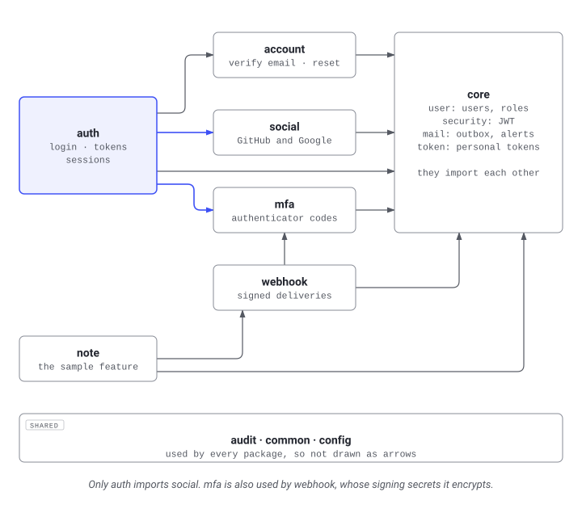
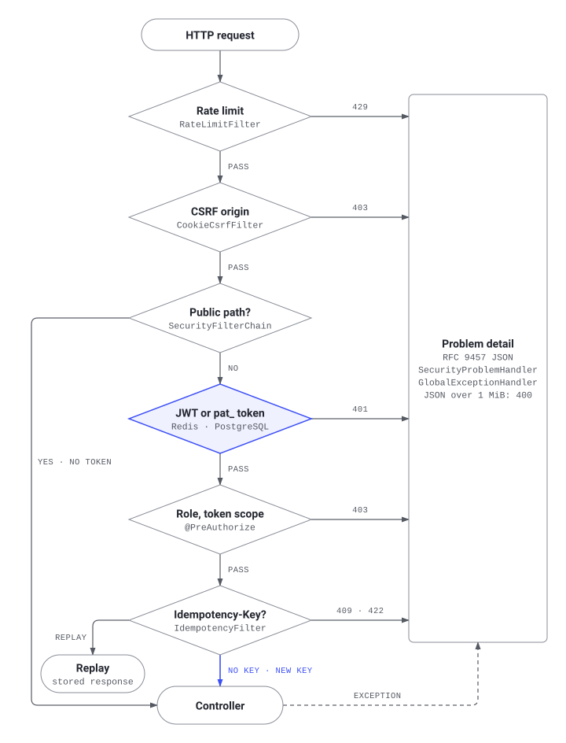

# Architecture

How the feature packages under `src/main/java/com/hikmethankolay/template/` depend on each other and how one API request passes through the filters into a feature, for contributors adding or removing a package. Verified against `e169ee0`.

## Overview

<picture>
  <source media="(prefers-color-scheme: dark)" srcset="docs/public/diagrams/package-dependencies-dark.svg" width="720" height="640">
  
</picture>

Arrows are `import com.hikmethankolay.template.<package>` statements. Every package imports at least one of `audit`, `common` and `config`, so those imports are not drawn; of the three, only `config` imports a feature package (`user`). The diagram is drawn by `package_dependencies` in [`docs/diagrams/ops.py`](docs/diagrams/ops.py).

## Code map

| Path | Role | Entry points | Kind |
|---|---|---|---|
| [`Application.java`](src/main/java/com/hikmethankolay/template/Application.java) | Entry point of the application | `main` | owned |
| [`account/`](src/main/java/com/hikmethankolay/template/account) | Account flows sent by email: email address verification and password reset with single-use tokens | `AccountController`, `AccountService`, `AccountMailer` | owned |
| [`audit/`](src/main/java/com/hikmethankolay/template/audit) | Security audit trail: who did what, from where | `AuditLog.record`, `AuditEvent` | owned |
| [`auth/`](src/main/java/com/hikmethankolay/template/auth) | Authentication feature: registration, login, token refresh and logout endpoints | `AuthController`, `SessionController`, `AuthService` | owned |
| [`common/`](src/main/java/com/hikmethankolay/template/common) | Cross-cutting web concerns: the domain exception type and the global RFC 9457 error handler | `ApiException`, `GlobalExceptionHandler`, `IdempotencyFilter` | owned |
| [`config/`](src/main/java/com/hikmethankolay/template/config) | Application configuration: typed `app.*` properties and the OpenAPI document | `AppProperties`, `OpenApiConfig` | owned |
| [`mail/`](src/main/java/com/hikmethankolay/template/mail) | Outgoing email through a transactional outbox, rendered from the templates in `src/main/resources/mail/` | `EmailOutbox.enqueue`, `MailRenderer`, `SecurityMailer` | owned |
| [`mfa/`](src/main/java/com/hikmethankolay/template/mfa) | Two-factor authentication: TOTP authenticator apps with encrypted secrets and single-use recovery codes | `MfaController`, `MfaService` | owned |
| [`note/`](src/main/java/com/hikmethankolay/template/note) | Sample feature: notes owned by a user, to copy for a first feature or delete | `NoteController`, `NoteService`, `NoteRepository` | owned |
| [`security/`](src/main/java/com/hikmethankolay/template/security) | Stateless JWT security: filter chains, token issuing, user lookup for login and brute-force protection | `SecurityConfig`, `TokenService`, `RateLimitFilter` | owned |
| [`social/`](src/main/java/com/hikmethankolay/template/social) | Login with GitHub and Google: provider configuration, the authorization code exchange, linking provider accounts to users | `SocialAccountController`, `SocialAccountService`, `SocialProfileClient` | owned |
| [`token/`](src/main/java/com/hikmethankolay/template/token) | Personal access tokens: long-lived, revocable API keys sent as `Authorization: Bearer pat_...` | `AccessTokenController`, `AccessTokenDecoder`, `AccessTokenPolicy` | owned |
| [`user/`](src/main/java/com/hikmethankolay/template/user) | User feature: entity, repository, service, REST endpoints and the initial-admin bootstrap | `UserController`, `UserService`, `PersonalDataProvider` | owned |
| [`webhook/`](src/main/java/com/hikmethankolay/template/webhook) | Outbound webhooks: signed HTTP POSTs to user-registered endpoints, sent through an outbox table with retries | `WebhookEvents.publish`, `WebhookController`, `WebhookDispatcher` | owned |

Package paths are relative to `src/main/java/com/hikmethankolay/template/`.

## Request flow

<picture>
  <source media="(prefers-color-scheme: dark)" srcset="docs/public/diagrams/request-pipeline-dark.svg" width="720" height="944">
  
</picture>

The checks in order, for `POST /api/v1/notes` with a bearer token:

1. `common/TraceIdResponseFilter.java:doFilterInternal` adds the trace id as the `X-Trace-Id` response header (`@Order(Ordered.HIGHEST_PRECEDENCE + 2)`).
2. `security/RateLimitFilter.java:doFilterInternal` counts the client IP in a Redis sliding window and answers `429` over the limit (`HIGHEST_PRECEDENCE + 3`).
3. `security/CookieCsrfFilter.java:doFilterInternal` rejects a cookie-authenticated, state-changing request from an origin that is not allowed with `403` (`HIGHEST_PRECEDENCE + 4`).
4. `security/SecurityConfig.java:apiFilterChain` (`@Order(2)`) takes the request because the path is not in `PUBLIC_PATHS`, which `publicFilterChain` (`@Order(1)`) matches; `bearerTokenResolver` reads the token from the `Authorization` header or the auth cookie.
5. `token/AccessTokenDecoder.java:decode` checks a `pat_` value against the database through `AccessTokenService` and passes any other value to the JWT decoder built in `SecurityConfig.jwtDecoder`.
6. `token/AccessTokenPolicy.java:authorize` requires an authenticated caller and limits what a personal access token may reach.
7. `common/IdempotencyFilter.java:doFilterInternal` runs after Spring Security, so it knows the caller, and replays or rejects a repeated `Idempotency-Key`.
8. `note/NoteController.java:create` calls `note/NoteService.java:create`, which takes a per-user advisory lock with `NoteRepository.lockUser`, checks the note limit with `NoteRepository.countByUserId`, saves the note and calls `WebhookEvents.publish` in the same transaction.

Errors from the security chain go through `security/SecurityProblemHandler.java:commence` (401) and `handle` (403) to `common/GlobalExceptionHandler.java`, which also renders every `ApiException` thrown by a service as a problem detail.

## Invariants

- Classes annotated `@RestController` must not depend on a Spring Data `Repository` or a JPA `@Entity`. Rules `controllersDoNotUseRepositories` and `controllersDoNotExposeEntities` in [`ArchitectureTest.java`](src/test/java/com/hikmethankolay/template/ArchitectureTest.java); the `ArchitectureTest` unit test fails.
- No class other than a controller depends on a `@RestController` class. Rule `nothingDependsOnControllers`; the `ArchitectureTest` unit test fails.
- Classes in `audit` and `common` must not depend on `account`, `auth`, `mail`, `mfa`, `note`, `security`, `social`, `token`, `user` or `webhook`. Rule `sharedPackagesDependOnNoFeature`; the `ArchitectureTest` unit test fails. `config` is not in the rule and imports `user`.
- No field injection, no `System.out`/`System.err`, no `java.util.logging`. Rules `noFieldInjection`, `noStandardStreams`, `noJavaUtilLogging`; the `ArchitectureTest` unit test fails.
- `@Transactional` goes on service methods only, and `spring.jpa.open-in-view` is `false`. Stated in [ADR 5](docs/src/content/docs/adr/0005-transactions-in-services.md); the repository half is enforced by `controllersDoNotUseRepositories`, the rest by nothing.
- Every feature package lives below `com.hikmethankolay.template`, where component scanning starts. Stated in the Javadoc of `Application.java`; nothing checks it.
- Nothing imports `note/`, so deleting the package and its tests removes the feature. Stated in [`guides/new-project.md`](docs/src/content/docs/guides/new-project.md); nothing enforces it.
- Only `auth` imports `social`. Stated in the package dependency diagram of [`guides/new-project.md`](docs/src/content/docs/guides/new-project.md) (source: `docs/diagrams/ops.py`); nothing enforces it.

## Design decisions

- [ADR 1: HS256 by default, RS256 when other services verify tokens](docs/src/content/docs/adr/0001-jwt-signing.md)
- [ADR 2: Redis-backed protections fail open, except login](docs/src/content/docs/adr/0002-redis-fail-open.md)
- [ADR 3: Emails go through a transactional outbox](docs/src/content/docs/adr/0003-email-outbox.md)
- [ADR 4: Doxygen for the Java reference](docs/src/content/docs/adr/0004-doxygen.md), superseded by ADR 6
- [ADR 5: Transactions belong to services, not controllers](docs/src/content/docs/adr/0005-transactions-in-services.md)
- [ADR 6: Javadoc for the Java reference](docs/src/content/docs/adr/0006-javadoc.md)
- [ADR 7: Emails are Thymeleaf templates with a text twin](docs/src/content/docs/adr/0007-email-templates.md)
- [ADR 8: Unsubscribe links are signed, stateless tokens](docs/src/content/docs/adr/0008-unsubscribe.md)
- [ADR 9: Security alerts, device recognition and owner broadcasts](docs/src/content/docs/adr/0009-security-alerts-and-broadcast.md)
- [ADR 10: Personal access tokens](docs/src/content/docs/adr/0010-personal-access-tokens.md)
- [ADR 11: Outbound webhooks](docs/src/content/docs/adr/0011-webhooks.md)
- [ADR 12: Idempotency keys for POST](docs/src/content/docs/adr/0012-idempotency-keys.md)
- [ADR 13: Optimistic locking with ETag and If-Match](docs/src/content/docs/adr/0013-optimistic-locking-etags.md)
- [ADR 14: Rate limiting and login lockout](docs/src/content/docs/adr/0014-rate-limiting.md)
- [ADR 15: Problem details for errors](docs/src/content/docs/adr/0015-problem-details.md)
- [ADR 16: Audit log](docs/src/content/docs/adr/0016-audit-log.md)
- [ADR 17: User suspension](docs/src/content/docs/adr/0017-user-suspension.md)
- [ADR 18: Scheduled jobs on several instances](docs/src/content/docs/adr/0018-multi-instance-scheduling.md)

## Common changes

Run `scripts/test.sh` after each one (`scripts/test.sh --unit` skips the Testcontainers integration tests).

### Add a table

1. Add `src/main/resources/db/migration/V23__<description>.sql`, the number after the last migration (`V22__audit_purge_batches_and_user_search_indexes.sql`). Never edit a migration that has already been applied.
2. For data about a user, reference `users(id)` with `ON DELETE CASCADE`.

### Add a feature package

1. Copy `note/` to a new package next to `user/` and rename the classes.
2. Add its migration as in "Add a table".
3. Add its errors to `ProblemType` in `common/` and to the Errors table in [`guides/api.md`](docs/src/content/docs/guides/api.md).
4. If it stores user data, implement `user/PersonalDataProvider` (`section`, `export`) so the data export at `GET /api/v1/users/me/export` includes it. `note/NoteDataProvider.java` is the example.
5. Copy `NoteIntegrationTest` and adapt it.
6. Regenerate the OpenAPI document and check the diff:

   ```bash
   scripts/test.sh -Dit.test=OpenApiSpecExportIntegrationTest -Dopenapi.update=true
   git diff api/openapi.json
   ```

### Add an error type

1. Add a constant to `ProblemType` in `common/ProblemType.java`.
2. Throw it from the service with `ApiException.notFound`, `.conflict`, `.badRequest`, `.preconditionFailed` or `.tooManyRequests`; `GlobalExceptionHandler` renders it.
3. Add a row to the Errors table in `guides/api.md`.

### Publish a webhook event

1. Add a constant to `WebhookEventType` in `webhook/` with its name and audience (`OWNER` or `ADMINS`).
2. Call `WebhookEvents.publish(type, userId, data)` inside the transaction of the change, as `NoteService.create` does.

### Make an endpoint public

1. Add the path to `SecurityConfig.PUBLIC_PATHS` in `security/SecurityConfig.java`; every other path goes through `apiFilterChain` and needs a valid token.
2. Regenerate the OpenAPI document as in "Add a feature package".
